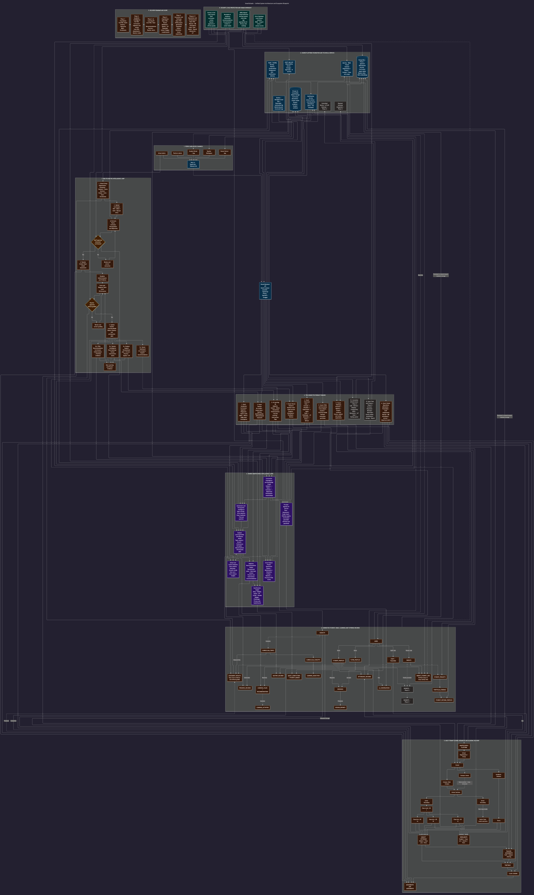

# SmartSchools Architecture and Delivery Blueprint

**Purpose:** decision-ready technical blueprint for a full-ecosystem proof of concept and staged production build
**Status:** planning baseline
**Pilot:** one school organisation, two campuses
**Hosting assumption:** AWS Africa (Cape Town), subject to production residency and privacy review

## 1. Product and POC objective

SmartSchools is a multi-tenant school platform and education intelligence layer. It connects school operations, curriculum, teaching, assessment, personalized learning, family engagement, STEM projects, attendance, finance, timetabling, transport, dismissal, and future pathways through shared identity, permissions, data, events, and governance.

The POC must demonstrate the whole ecosystem as connected, working flows. It does not need to implement every later-stage operational capability at production depth. Payment, messaging, maps/GPS, and device interactions use provider sandboxes or a contract-compatible simulator until vendors and policies are selected.

The primary demonstration traces a student from an approved curriculum and assessment through updated mastery, a personalized learning action, teacher intervention, parent visibility, and curriculum-linked project evidence. Operational demonstrations cover two-campus tenant scoping, attendance, a payment test transaction, timetable constraints, transport events, and verified pickup/handover.

## 2. System shape

Use a modular monolith with explicit domain ownership and versioned external contracts. Deploy the API and asynchronous workers as separate containers from the same codebase initially. Extract a service only when usage, reliability, or team ownership justifies it.

### Experience applications

- **Next.js + TypeScript web:** school/group administration, teacher workspace, platform administration, and responsive browser access.
- **Expo + React Native mobile:** role-based student, parent/guardian, teacher, and operational workspaces for iOS and Android.
- Both clients use the same versioned backend API. Client-side role visibility improves usability; backend authorization is authoritative.

### Backend modules

Organize the NestJS application around these bounded domains:

1. Identity, organisation, tenant policy, and authorization
2. Academic structure, enrolment, subjects, and teacher assignments
3. Curriculum ingestion, review, versioning, and teaching resources
4. Assessments, submissions, grading, and reporting
5. Learning profile, mastery, recommendations, tutoring, and interventions
6. Classroom, teacher preparation, STEM projects, portfolio, and engagement
7. Family relationships, communication, consent, and notifications
8. Operations, attendance, timetable, transport, and dismissal
9. Fees, invoices, payment integration, allocation, and receipts
10. Analytics, audit, integrations, and platform operations

Each domain owns its rules and writes through its module boundary. Cross-domain changes use published events rather than direct writes into another domain's tables.

### Shared intelligence

- Versioned curriculum graph: subject, class/grade, term, topic, concept, objective, skill, prerequisite, and approved resource.
- Student learning model: evidence-backed mastery estimates, misconceptions, learning history, recommendations, and interventions.
- AI orchestration adapter: provider selection, prompt versions, approved-content retrieval, safety checks, evaluation, cost controls, and traceable output provenance.
- Specialist workflows: tutor, teacher preparation, assessment support, project generation, analytics, and pathway exploration.
- AI outputs remain guidance. Official grades, published teaching resources, and consequential interventions require authorized human review.

### Data and asynchronous work

- **PostgreSQL + pgvector:** transactional records, relational curriculum structures, event outbox, and approved-resource embeddings.
- **Prisma:** schema migrations and typed data access, with explicit tenant predicates and transactions at module boundaries.
- **S3:** private curriculum uploads, generated resources, reports, and portfolio evidence. Store metadata and access policy in PostgreSQL; issue short-lived authorized URLs.
- **AWS queueing:** transactional outbox dispatches domain events to queues; consumers are idempotent. Use a dead-letter path and replay controls for failed jobs.
- **Cache:** introduce only for measured hot reads or short-lived data; never make cache state the source of truth.

## 3. AWS deployment baseline

Deploy in AWS Africa (Cape Town) as the pilot region. AWS documents RDS for PostgreSQL availability in that region; verify current availability, service quotas, latency, and cost for every chosen service before provisioning.

| Concern | Initial choice | Boundary / operational rule |
|---|---|---|
| Web delivery | CloudFront with static assets and web app hosting | TLS, security headers, separate environments |
| API and workers | ECS Fargate containers | Private subnets; API and workers scale independently |
| Database | RDS for PostgreSQL with pgvector | Private network, encryption, backups, migrations, restore drills |
| Files | Private S3 buckets | Block public access, encryption, lifecycle and audit policies |
| Events and jobs | Transactional outbox plus SQS queues | Idempotent consumers, retry policy, dead-letter queue |
| Identity | Cognito for authentication and MFA options | NestJS enforces tenant, campus, role, and relationship authorization |
| Secrets | AWS Secrets Manager / Parameter Store | No credentials in source, images, or client apps |
| Telemetry | CloudWatch logs/metrics/alarms plus tracing | Correlation IDs; redact child, health, and payment secrets/data |
| Edge protection | AWS WAF and rate limits | Protect public endpoints, login, uploads, and webhook routes |
| Environments | Separate dev, staging, production accounts or isolated environments | Production data is never copied into development fixtures |

Infrastructure must be described as code, reviewed through GitHub, and deployed through CI/CD with a human production approval. Keep application, database, and object-storage backups and test restoration rather than treating backup creation as proof of recovery.

## 4. Tenant model, identity, and authorization

### Tenant and academic hierarchy

`Platform → Organisation/Tenant → School → Campus → Academic year → Term → Section → Class level → Class arm → Subject offering → Teacher assignment`

Student identity is stable; enrolment records are time-bounded placements. Campus moves and class changes create history instead of rewriting prior placements. A parent or guardian may be linked to multiple students and campuses with separate permissions for each relationship.

### Authorization rules

- Every school-owned record has a tenant identifier; add campus and other scope identifiers where domain policy requires them.
- Resolve user identity and active scope from the authenticated server-side session. Do not trust tenant IDs, child IDs, or role claims supplied by clients without database-backed authorization checks.
- Model staff RBAC and contextual relationship permissions separately. Guardian permissions include academic, attendance, finance, communication, consent, emergency-contact, and pickup capabilities.
- Apply database row-level security as defense in depth. Use transaction-scoped tenant context, forced policies where supported, and tests that exercise the real application database role.
- Audit sensitive student-record access, permission changes, curriculum approvals, official grade approvals, AI-generated artifacts, payment transitions, pickup authorization, and handover confirmation.

## 5. Core data domains

The following are domain groups, not a finalized physical schema. Define keys, lifecycle, retention, and ownership in Phase 0.

| Domain | Representative records |
|---|---|
| Organisation and identity | Tenant, organisation, school, campus, user, role, permission, session, authentication event |
| Family and relationship | Family, guardian relationship, child link, relationship permission, invite, emergency contact, consent |
| Academic structure | Academic year, term, class level, class arm, subject, offering, enrolment, teacher assignment |
| Curriculum | Curriculum, version, mapping, topic, concept, objective, skill, prerequisite, source document, approved resource |
| Teaching and assessment | Lesson resource, approval, teaching session, assessment, question, submission, mark, result, report card |
| Learning intelligence | Learning profile, evidence, mastery record, recommendation, plan, practice attempt, tutor session, intervention |
| STEM and engagement | Project, submission, portfolio evidence, quest, badge, points transaction, challenge, moderation record |
| Operations | Attendance event, timetable/version, period, room, constraint, facility, transport assignment, trip event |
| Finance | Billing entity, fee item, invoice, payment transaction, webhook event, allocation, ledger entry, receipt, refund |
| Safety and governance | Audit log, access review, retention policy, AI review, pickup request, collector authorization, handover record |

Use append-only or immutable history for financial ledger entries, audit records, approvals, and child handover evidence. Define correction workflows instead of silently overwriting these records.

## 6. API and event contracts

- Publish a versioned REST API with OpenAPI documentation. Keep external contracts stable and additive within a major version.
- Use an event envelope with `eventId`, `eventType`, `schemaVersion`, `occurredAt`, `tenantId`, optional `campusId`, `actorId`, `correlationId`, and a domain-specific payload.
- Persist the domain mutation and outbox record in the same database transaction. A dispatcher publishes pending outbox rows; consumers track processed event IDs and make side effects idempotent.
- Initial event families: `StudentEnrolled`, `CurriculumVersionApproved`, `AssessmentMarked`, `MasteryUpdated`, `LearningRecommendationCreated`, `AttendanceRecorded`, `PaymentVerified`, `PaymentAllocated`, `PickupAuthorised`, and `StudentHandoverConfirmed`.
- Keep personally identifying details and assessment answers out of event metadata. Consumers fetch only data they are authorized to process.
- Webhooks are authenticated, signature-checked over raw request bytes, acknowledged quickly, and processed asynchronously. Store provider event IDs to reject duplicate effects.

## 7. Integration and AI boundaries

### Payments

Start with Paystack test mode behind a `PaymentProvider` adapter. The backend creates transactions, verifies status server-side, validates webhook signatures, handles duplicate events idempotently, allocates verified funds, and writes an auditable ledger entry and receipt. Never let the browser or mobile app set an invoice to paid. Keep test and live secrets separate and server-side.

### Messaging, transport, and devices

Use provider adapters for email/SMS/push, maps/GPS, QR/RFID, and school hardware. The POC uses sandbox providers where available and a device-event simulator for transport, gate, and attendance contracts. A simulated event must be marked as simulated in the data and UI.

### AI runtime

Keep AI provider choice behind a `ModelProvider` interface. Phase 0 selects the first runtime using data-processing terms, regional availability, supported languages/curricula, output quality, latency, and cost. Retrieval can return only approved curriculum/resources in the caller's authorized tenant and scope. Record model/provider, prompt version, retrieved source IDs, guardrail outcome, and human review state without storing unnecessary sensitive prompt data.

## 8. Delivery phases and exit criteria

| Phase | Build focus | Exit evidence |
|---|---|---|
| 0. Architecture and domain design | Threat model, tenant/relationship matrix, module ownership, data model, API/events, AWS topology, AI/provider evaluation, delivery pipeline | Decisions reviewed; diagram and contracts approved; measurable POC baseline agreed |
| 1. Secure platform foundation | Tenant hierarchy, authentication, roles, campus scopes, enrolments, audit, infrastructure and environments | Two-campus access tests pass; migrations and restore process demonstrated |
| 2. Curriculum and academics | Upload, extraction, review, approval/versioning, subjects, assessments, results | Approved curriculum provenance is traceable; assessment maps to correct student/topic |
| 3. Learning intelligence | Evidence, mastery, prerequisite gaps, recommendations, grounded tutor, practice | Practice/assessment updates mastery; tutor uses approved sources and safe refusal/escalation behavior |
| 4. Teacher, family, STEM, engagement | Teacher content generation/approval, guardian links, student/parent views, projects, portfolio, quests | Teacher approval gates work; multi-child permissions differ correctly; project evidence is linked |
| 5. Operational POC breadth | Attendance, sandbox payment, timetable solver, transport simulator, pickup/handover | Payment replay has one effect; timetable has no hard conflicts; pickup requires verified authorization and staff handover |
| 6. Hardening and expansion | Security review, accessibility, performance, monitoring, backup/restore, production policies | Operational readiness reviewed; production gates and support ownership agreed |

## 9. Test and acceptance strategy

Automate these checks before the POC is accepted:

- **Tenant isolation:** cross-tenant and cross-campus reads/writes fail for API, background jobs, exports, object URLs, and database policies.
- **Family authorization:** guardians see only linked children and only capabilities granted on each relationship; revocation takes effect server-side.
- **Curriculum lifecycle:** extraction remains a draft until review; approval creates a version; resources and assessments retain version/source provenance.
- **Learning loop:** assessment and practice evidence update the intended topic mastery and recommendation; duplicate events do not double-apply evidence.
- **AI governance:** retrieval cannot cross tenants; outputs cite approved sources internally; unsafe prompts are handled by guardrails; generated content cannot publish without the configured educator approval.
- **Payments:** invalid signatures are rejected; duplicate/replayed webhooks produce one allocation; browser callbacks alone cannot confirm settlement.
- **Timetable:** deterministic solver rejects teacher, class, or room conflicts and reports unsatisfied constraints.
- **Child handover:** QR/link possession alone is insufficient; permission, collector validation, staff confirmation, and an audit record are required.
- **Operations:** queue retries, dead-letter handling, migration rollback/recovery, database restore, and alerting are exercised in staging.
- **Experience quality:** role-based workflows work on mobile and desktop; keyboard/accessibility checks cover core tasks.

## 10. Engineering workflow and AI coding tools

- Use GitHub as the source of truth: protected main branch, small feature branches, reviewable PRs, issue-linked acceptance criteria, and required CI.
- Use Cursor and Claude to author code against checked-in architecture notes, API contracts, and domain rules. Use Codex for independent review of design, changes, edge cases, and documentation consistency.
- Require human review for authorization, migrations, payment handling, AI safety, privacy, and production infrastructure changes.
- CI runs formatting, linting, type checks, unit/integration tests, dependency/security scans, migration checks, and build artifacts. Production deploys require a human approval and a rollback path.
- Keep AI instructions scoped by application area, document architectural decisions (ADRs), and reject generated changes that bypass module ownership or authorization rules.

## 11. Production gates and deferred decisions

Before production, confirm with qualified privacy/security stakeholders: data residency and cross-border processing, child-data consent and retention, incident response, access reviews, data export/deletion, legal basis, and school operating procedures. AWS Cape Town is the planning default, not a legal conclusion about residency suitability.

The architecture deliberately leaves replaceable: first AI runtime/model, messaging vendor, GPS/device vendors, biometric policy, and live payment settlement arrangement. Each must be selected through Phase 0 review and integrated behind the stated adapter. Fees, payroll, biometrics, and physical IoT infrastructure are later rollout capabilities beyond the first POC depth.

## 12. Architecture diagrams

- [System overview](SmartSchools_System_Overview.mmd)
- [End-to-end learning loop](SmartSchools_Learning_Loop.mmd)
- [Security and authorization boundaries](SmartSchools_Security_Boundaries.mmd)
- [Events and external integrations](SmartSchools_Events_and_Integrations.mmd)

## Reference documentation

- [Expo documentation](https://docs.expo.dev/)
- [NestJS modules](https://docs.nestjs.com/architecture/modules)
- [AWS RDS PostgreSQL regional availability](https://docs.aws.amazon.com/AmazonRDS/latest/UserGuide/Concepts.RDS_Fea_Regions_DB-eng.Feature.MultiAZDBClusters.html)
- [Paystack webhook documentation](https://paystack.com/docs/v2/developer-tools/integration/webhooks)

